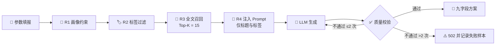

<div align="center">


<h1>Tuomato · 拓码途</h1>

<p><b>面向计算机学生的 AI 求职项目选题引擎</b><br />
以公开的岗位技能画像为依据，按你的技术栈、目标岗位与可用周期，生成一份可落地、可写进简历的项目方案。</p>

<p>
  
  
  
  
</p>

</div>


<div align="center">

<table>
  <tr>
    <td align="center" width="20%">
      <br />
      <b>后端</b><br />
      <sub>FastAPI 0.115<br />Uvicorn 0.32<br />Pydantic 2.10</sub>
    </td>
    <td align="center" width="20%">
      <br />
      <b>前端</b><br />
      <sub>Vue 3.5<br />Vite 6<br />Element Plus 2.8</sub>
    </td>
    <td align="center" width="20%">
      <br />
      <b>数据</b><br />
      <sub>MySQL 8.0<br />FULLTEXT / ngram<br />SQLAlchemy 2.0</sub>
    </td>
    <td align="center" width="20%">
      <br />
      <b>生成</b><br />
      <sub>DeepSeek API<br />httpx + selectolax<br />Playwright 兜底</sub>
    </td>
    <td align="center" width="20%">
      <br />
      <b>部署</b><br />
      <sub>Docker Compose<br />Nginx 1.26<br />pandas 2.2</sub>
    </td>
  </tr>
</table>

<sub>以上版本为方案 §4.3 锁定的目标版本；除 <code>python-docx</code> 已在本地验证外，其余均处于「待验证」状态。</sub>

</div>

---

> **项目状态**
>
> 当前仓库只有设计文档，尚无业务代码。开发计划见方案 §7 的五个阶段，每阶段设有质量门，未达标不进入下一阶段。
> README 会在代码落地后按实际情况更新，不以计划冒充进展。

## 💡 为什么做这件事

学生不缺「做个后台管理系统」这类想法，缺的是**企业现在到底想看什么样的项目**这个判断依据。

| 现有替代品 | 已有能力 | 缺口 |
| :--- | :--- | :--- |
| 通用大模型对话 | 生成快、门槛低 | 无求职针对性、无难度分级、无岗位适配、结果不可沉淀 |
| GitHub / Gitee | 项目数量极大 | 无求职维度筛选、无新手引导、无匹配能力 |
| 牛客 / 掘金 | 有经验分享与面经 | 零散、非结构化、无生成能力 |
| 培训机构项目库 | 有完整路线 | 同质化严重，面试官一眼识别为模板 |

**差异化**：以招聘岗位的**技能画像**作为生成约束，而不是让大模型自由发挥。产出质量不取决于模型多强，而取决于画像数据多准——把「AI 生成」这个不稳定的东西，锚定在一份可控、可版本化的数据资产上。

## 🧩 功能范围

| 模块 | 能力 | 优先级 |
| :--- | :--- | :---: |
| 🧾 参数填报 | 专业、目标岗位、掌握技术、可用周期、能力自评、意向行业 | `P0` |
| ✨ 一键生成 | 画像召回 + Prompt 组装 + LLM 调用，返回结构化九字段方案 | `P0` |
| 🖥️ 结果渲染 | 按固定结构分块展示，支持 Markdown | `P0` |
| 🗂️ 历史记录 | 生成结果持久化，列表与详情可查 | `P1` |
| 📤 方案导出 | 导出为 `.docx` / `.md` | `P1` |
| 🔥 岗位热度 | 展示各岗位高频技术栈与常见选题方向 | `P1` |
| 🕸️ 合规采集 | 官方 API / 静态页优先，低频限速，失败即放弃 | `P1` |
| 🏷️ 清洗标签 | 双重去重、标签抽取、难度打分 | `P1` |
| 🧮 难度打分 | 三维加权模型自动归档到五档 | `P1` |
| 📚 画像版本化 | 按岗位聚合画像，带批次号、生效标记与回滚 | `P1` |
| ✅ 质量校验 | 结构 / 黑名单 / 技术栈匹配 / 工程含量 / 篇幅五道校验，不合格重生成 | `P1` |
| 👤 账号体系 | 注册登录，隔离历史记录 | `P2` |
| ⚖️ 方案对比 | 多份方案并列对比 | `P2` |

## 🏗️ 架构

采用**模块化单体**（Modular Monolith），而非微服务。单人开发、单机部署，引入服务发现与分布式事务只会带来本不需要的复杂度；按业务能力划分边界，需要拆分时边界已经存在。

```
┌─────────────────────────────────────────────────┐
│  API 层       路由 · 参数校验 · 鉴权 · 响应封装   │
├─────────────────────────────────────────────────┤
│  Engine 层    召回 · Prompt · LLM 调用 · 质量校验 │
├─────────────────────────────────────────────────┤
│  Data 层      清洗 · 标签 · 难度打分 · 画像聚合   │
├─────────────────────────────────────────────────┤
│  Collector 层 公开数据获取 · 限频 · 重试 · 落盘   │
└─────────────────────────────────────────────────┘
              上层依赖下层，禁止反向依赖
```

| 层 | 对外接口 | 职责 |
| :--- | :--- | :--- |
| Collector | `collect_source(cfg) -> RawBatch` | 公开数据获取、限频、重试、原始落盘 |
| Data | `build_profile(job) -> JobProfile` | 清洗、去重、标签、难度打分、画像聚合 |
| Engine | `generate(query) -> ProjectPlan` | 召回、Prompt 组装、LLM 调用、质量校验 |
| API | REST `/api/v1/*` | HTTP 路由、参数校验、鉴权、响应封装 |

<details>
<summary><b>📐 关键设计决策</b></summary>

<br />

| 决策点 | 结论 | 理由 |
| :--- | :--- | :--- |
| 单体 or 微服务 | 模块化单体 | 单人开发，避免引入分布式复杂度 |
| 采集 or 人工种子集 | 采集为辅、人工种子集为主 | MVP 阶段人工数据质量可控，且规避合规风险 |
| 向量库 or 全文检索 | 先用 MySQL FULLTEXT | 避免过早引入新组件；效果不足再升级 |
| 实时生成 or 预生成 | 实时 + 结果持久化缓存 | 相同参数 24 小时内命中缓存，降低 LLM 成本 |
| 画像存储 | 按批次快照，不覆盖 | 保证可回溯、可回滚，生成结果可追溯到画像版本 |

</details>

## 🔍 生成链路



**生成结果的九个字段是硬约定**：`project_name` · `background` · `tech_arch` · `core_features` · `highlights` · `dev_steps` · `difficulties` · `resume_desc` · `interview_points`。缺一不可——前端渲染、文档导出、质量校验全部以此为准。

## 🧮 难度评分模型

把主观的「难度」转成可计算的分数，再用人工标注样本校准。

| 维度 | 含义 | 权重 |
| :--- | :--- | ---: |
| **T** 技术广度 | 所涉技术栈的数量与跨度 | `0.35` |
| **D** 实现深度 | 是否涉及并发、分布式、性能优化等非 CRUD 内容 | `0.45` |
| **S** 业务复杂度 | 业务规则与领域模型的复杂程度 | `0.20` |

`难度分 = T×0.35 + D×0.45 + S×0.20`，结果落在 `[1, 5]` 后四舍五入归档：

| 得分区间 | 难度档位 | 定位 |
| :---: | :--- | :--- |
| `1.0 – 1.8` | 入门练手级 | 单技术栈，功能明确，适合零基础 |
| `1.9 – 2.6` | 简历基础级 | 双技术栈，有基本分层，适合补简历 |
| `2.7 – 3.4` | 简历进阶级 | 多技术栈，含缓存或异步等工程点 |
| `3.5 – 4.2` | 工程实战级 | 含性能优化、并发或数据治理 |
| `4.3 – 5.0` | 竞赛获奖级 | 含算法或架构难题，具备方案设计含量 |

## 🗺️ 迭代路线

阶段之间串行依赖，前序质量门未过不得启动后续阶段。

| 阶段 | 目标 | 质量门（摘要） |
| :--- | :--- | :--- |
| **① MVP 闭环** | 打通「填表 → 生成 → 展示」 | 九字段结构完整率 100%；异常返回 502 而非堆栈 |
| **② 数据自动化** | 采集、清洗、打分、画像自动构建 | 难度打分与人工判断一致率 ≥ 80%；生成可用率 ≥ 85% |
| **③ 工程化** | 历史、导出、缓存、限流、可观测 | 导出文件可打开；缓存命中与限流可验证 |
| **④ 部署上线** | 公网可访问 + 合规清单全过 | HTTPS 生效；仓库无敏感数据；合规六项全勾 |
| **⑤ 技术文档** | 产出符合规范的 Word 技术文档 | 六章无缺项；命令从零可复现 |

## 🛡️ 合规红线

这个项目处理的是他人发布的招聘信息与课题信息，因此**先划边界再写代码**。三条红线在系统层面强制落实：

| 红线 | 含义 | 落实方式 |
| :--- | :--- | :--- |
| 🚫 **不存储原文** | 数据库不落任何他人正文 | 只存标题、自建摘要、标签、来源链接 |
| 🚫 **不对外分发** | 不向用户展示他人原文 | 接口只返回结构化字段，原文一律跳转来源站 |
| 🚫 **不绕过限制** | 不破解登录、验证码、付费墙 | 仅采公开页面；遵守 robots；单站点间隔 3–5 秒；失败即放弃 |

### ⚠️ 免责声明

- 本项目**仅用于学习与研究**，不提供任何商业化服务。
- 数据库仅存储结构化特征（技能关键词频次、标签、难度、来源链接），**不存储、不复制、不二次分发**任何原文内容。
- 本项目**不绕过**任何网站的技术限制与访问控制，采集失败即放弃。
- 生成内容由大模型基于结构化画像产出，仅供选题参考，**不构成对任何企业真实招聘要求的承诺**。

## 🚀 快速开始

> 尚未实现。以下为方案 §4.4 的目标步骤，代码落地后按实际命令更新。

```bash
# 1. 后端
cd backend
python -m venv .venv && source .venv/bin/activate   # Windows: .venv\Scripts\activate
pip install -r requirements.txt
playwright install chromium
cp .env.example .env                                 # 填入数据库连接串与 LLM API Key
python scripts/init_db.py
uvicorn app.main:app --reload                        # http://127.0.0.1:8000/docs

# 2. 前端
cd ../frontend
npm install && npm run dev
```

**环境要求**：Python 3.11+ · MySQL 8.0 · Node.js 18+

## 📁 目录结构

```text
Tuomato/
├── backend/
│   ├── app/
│   │   ├── api/          # 接口层：generate / records / profile / export
│   │   ├── engine/       # 引擎层：retriever / prompt / llm_client / validator
│   │   ├── data/         # 数据层：cleaner / tagger / scorer / profiler
│   │   ├── collector/    # 采集层：base + sources（一源一文件）
│   │   ├── models/       # ORM 模型
│   │   ├── schemas/      # Pydantic 请求 / 响应模型
│   │   ├── core/         # 配置、日志、异常
│   │   └── main.py
│   ├── scripts/          # 建表、导种子数据、构建画像
│   ├── data/seed/        # 人工种子数据集（JSON / CSV）
│   └── tests/
├── frontend/
│   └── src/              # views / components / api / router
├── deploy/               # docker-compose · nginx.conf · init.sql
└── README.md
```

## 📄 设计文档

完整设计见仓库根目录的《AI求职项目智能生成平台——全局落地开发方案 V2.0》，涵盖需求依据、架构设计、接口契约、数据模型、召回策略、合规清单与阶段质量门。

<details>
<summary><b>📊 接口速览</b></summary>

<br />

| 方法 | 路径 | 用途 |
| :---: | :--- | :--- |
| `POST` | `/api/v1/generate` | 生成项目方案（幂等：相同参数 24h 内命中缓存） |
| `GET` | `/api/v1/records` | 查询生成历史 |
| `GET` | `/api/v1/records/{id}` | 查看单条记录详情 |
| `POST` | `/api/v1/export` | 导出方案为 `.docx` / `.md` |
| `GET` | `/api/v1/profile/jobs` | 获取支持的岗位列表 |
| `GET` | `/api/v1/profile/{job}` | 获取某岗位的画像内容 |
| `GET` | `/api/v1/health` | 健康检查 |

统一错误码：`400` 参数非法 · `429` 触发限流 · `502` 大模型调用失败 · `503` 画像未构建或已过期。

</details>

---

<div align="center">

<sub>代码与自建数据可开源；采集到的原始数据、他人 JD 文本与赛事真题内容不在开源范围内。</sub>

</div>
